# Manuel d'utilisation de Voxile

Ce manuel explique Voxile pas à pas, de l'installation à chaque fonction. Il suit la version **0.4.0**. Pas besoin d'être technicien : si tu sais glisser une app dans Applications et cliquer dans les Réglages de ton Mac, tu sais tout faire.

Les images viennent des rendus de l'app et du film de présentation. Les noms, les mails et les chiffres qu'on y voit sont des exemples.

## Sommaire

1. [Voxile en bref](#1-voxile-en-bref)
2. [Installer Voxile](#2-installer-voxile)
3. [La prise en main, étape par étape](#3-la-prise-en-main-étape-par-étape)
4. [Créer ta clé Groq (gratuite)](#4-créer-ta-clé-groq-gratuite)
5. [Dicter](#5-dicter)
6. [L'encoche et le Centre](#6-lencoche-et-le-centre)
7. [Commandes à la voix](#7-commandes-à-la-voix)
8. [Réunions](#8-réunions)
9. [Claude Code dans l'encoche](#9-claude-code-dans-lencoche)
10. [Tes apps](#10-tes-apps)
11. [La fenêtre de Voxile](#11-la-fenêtre-de-voxile)
12. [Les réglages](#12-les-réglages)
13. [Mises à jour](#13-mises-à-jour)
14. [Si tu venais de Verbe](#14-si-tu-venais-de-verbe)
15. [Désinstaller](#15-désinstaller)
16. [Questions fréquentes et dépannage](#16-questions-fréquentes-et-dépannage)

---

## 1. Voxile en bref

Voxile est une app de dictée vocale pour Mac. Tu cliques n'importe où (un mail, un document, une barre de recherche, le Terminal), tu **tiens la touche fn**, tu parles, tu relâches. Le texte propre s'écrit à l'endroit du curseur.

Tout se passe dans l'**encoche** du MacBook : le texte s'affiche en direct pendant que tu parles, avec ta voix qui s'anime et l'icône de l'app où le texte va s'écrire.

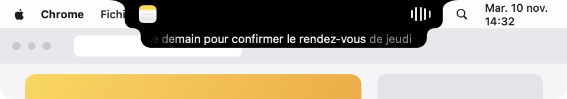

*L'encoche pendant une dictée : l'icône de l'app qui reçoit le texte à gauche, ta voix à droite, le texte en dessous.*

Voxile fait aussi d'autres choses depuis l'encoche : minuteur et réveil, étagère à fichiers, rappels et notes à la voix, notes de réunion, suivi de Claude Code, nouveautés de tes apps. Tout est décrit plus bas.

**Ce qu'il faut**

- Un Mac **Apple Silicon** (puce M1 ou plus récente).
- **macOS 26**.
- Une clé Groq gratuite pour la transcription rapide (voir [la section 4](#4-créer-ta-clé-groq-gratuite)). Sans clé, seule la dictée intégrée au Mac écrit.

**Ce qui part de ton Mac, ce qui reste**

- Ta voix est envoyée à Groq, pour être écrite, seulement quand tu tiens fn, ou pendant une réunion que tu notes.
- Tes dictées, tes notes et tes mots restent sur ton Mac.
- Les clés de tes apps sont rangées dans le Trousseau du Mac.

---

## 2. Installer Voxile

1. Va sur la [page des versions](https://github.com/proladislas-rgb/dictee-mac/releases/latest) et télécharge le fichier `Voxile-<version>.dmg` (par exemple `Voxile-0.4.0.dmg`).
2. Ouvre le fichier. Glisse **Voxile** sur le dossier **Applications**.
3. Ouvre Voxile depuis Applications. **La première fois, macOS refuse.** C'est normal, voir juste en dessous.

Si tu lances Voxile directement depuis l'image disque, il propose de lui-même de se copier dans Applications (« Placer Voxile dans Applications ? »). Accepte avec **Placer dans Applications** : il se relance depuis là.

### Première ouverture

Voxile n'est pas signé par un compte développeur Apple (c'est payant, le projet reste gratuit). Sur un Mac récent, le clic droit puis Ouvrir ne suffit plus. Fais ceci, une seule fois :

1. Ouvre Voxile. La fenêtre qui s'affiche propose « Placer dans la corbeille » ou « Terminé ». Clique sur **Terminé**. Surtout pas sur la corbeille.
2. Ouvre Réglages Système › **Confidentialité et sécurité**. Descends tout en bas et clique sur **Ouvrir quand même**. Confirme avec ton mot de passe ou Touch ID.
3. Rouvre Voxile depuis Applications.

Pour les habitués du Terminal, la même chose en une commande : `xattr -dr com.apple.quarantine /Applications/Voxile.app`

Au premier lancement, la prise en main démarre toute seule.

---

## 3. La prise en main, étape par étape

Un écran de bienvenue, puis cinq petites cartes. Compte deux minutes.

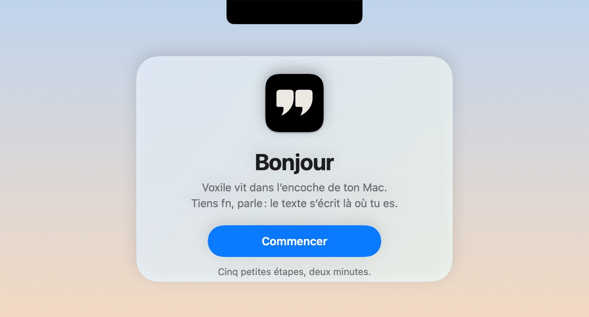

Clique sur **Commencer**. Chaque carte pose une question. Tu peux passer avec **Plus tard** et reprendre plus tard : Réglages › **Revoir la prise en main**, ou le menu de l'icône de Voxile › **Prise en main…**.

Voxile a besoin de trois autorisations de macOS. Elles sont demandées dans cet ordre :

| Étape | Autorisation | À quoi elle sert |
|---|---|---|
| 1. Le micro | Micro | Voxile t'entend quand tu dictes. Il n'écoute que pendant que tu tiens fn, jamais le reste du temps. |
| 2. Écrire dans tes apps | Accessibilité | Voxile pose le texte là où est ton curseur, dans n'importe quelle app. |
| 3. La touche fn | Surveillance de l'entrée | Voxile reconnaît quand tu tiens ou tapes sur fn. |

Pour chacune, clique sur le bouton bleu de la carte (**Autoriser le micro**, **Autoriser**). macOS ouvre sa propre fenêtre : suis ses instructions. La carte se coche en vert quand c'est bon.

### Étape 1 : le micro

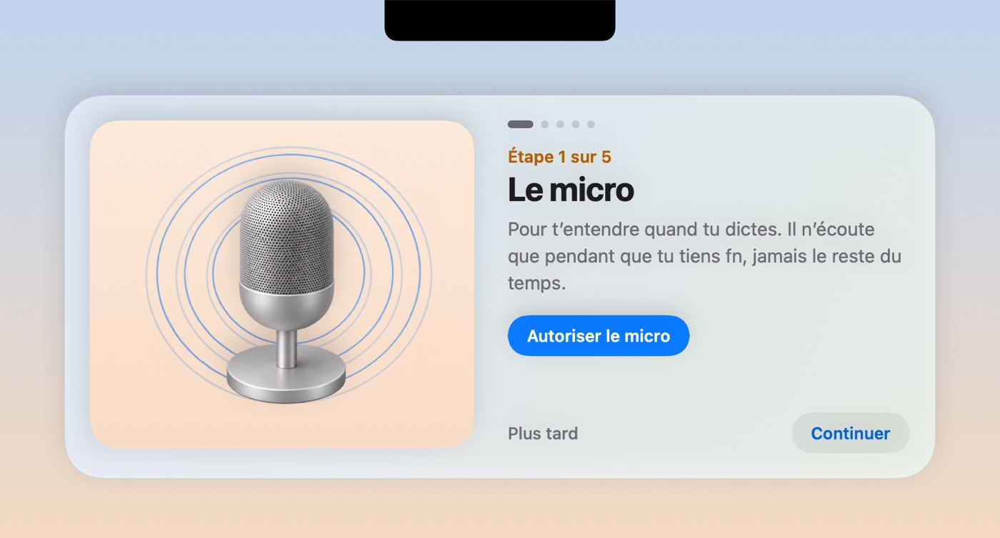

Clique sur **Autoriser le micro**. Si tu as refusé par erreur, le bouton devient **Ouvrir les Réglages** : active Voxile dans Réglages Système › Confidentialité et sécurité › Micro.

### Étape 2 : écrire dans tes apps

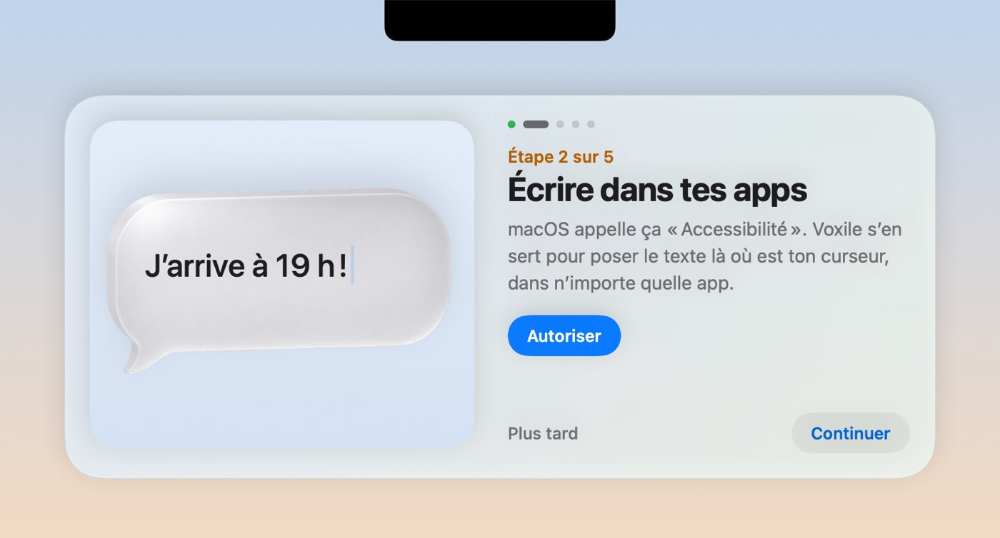

macOS appelle ça « Accessibilité ». Clique sur **Autoriser** et active Voxile dans la liste.

### Étape 3 : la touche fn

C'est l'étape qu'on rate le plus souvent. Après l'autorisation « Surveillance de l'entrée », Voxile vérifie ce que fait ta touche 🌐 (la touche fn des Mac récents). Si elle ouvre les emoji, ou fait autre chose que « Ne rien faire », la carte te le dit et propose **Ouvrir le volet Clavier**.

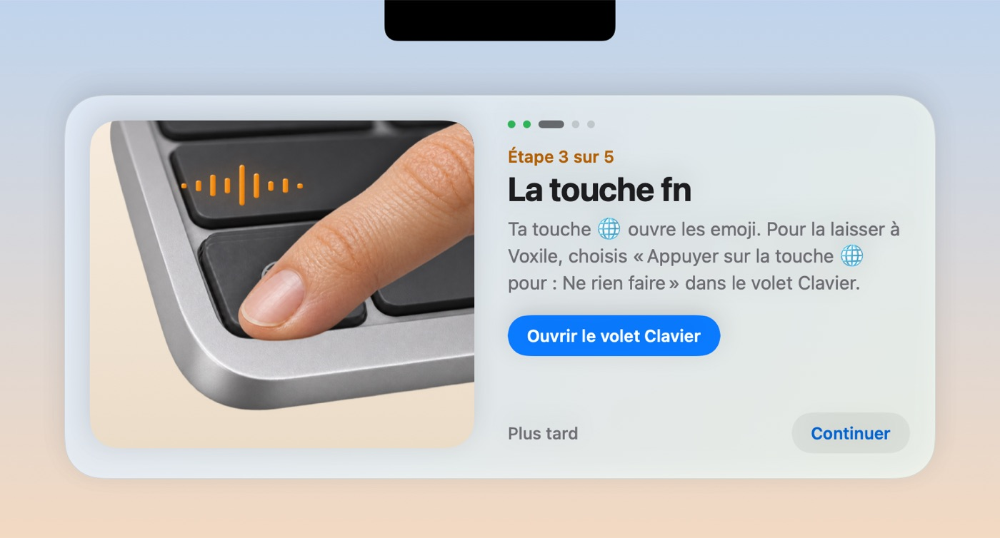

Dans Réglages Système › Clavier, règle : **Appuyer sur la touche 🌐 pour › Ne rien faire**.

Quand c'est fait, la carte affiche « fn est à toi » et te propose un essai : appuie deux fois vite sur fn. Si rien d'autre ne s'ouvre, c'est réglé.

### Étape 4 : la clé Groq

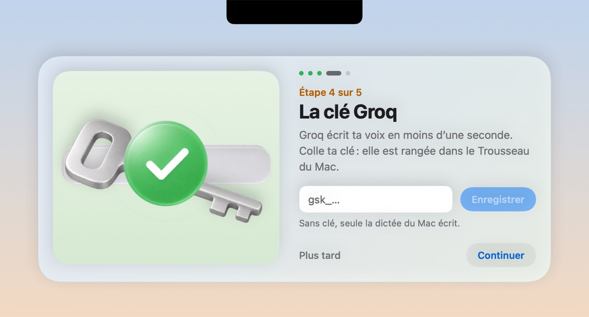

Colle ta clé dans le champ (elle commence par `gsk_`) puis clique sur **Enregistrer**. Elle est rangée dans le Trousseau du Mac. Pour savoir où la créer, voir [la section 4](#4-créer-ta-clé-groq-gratuite).

Si tu n'as pas de clé, tu peux passer : « Sans clé, seule la dictée du Mac écrit. »

### Étape 5 : essaie

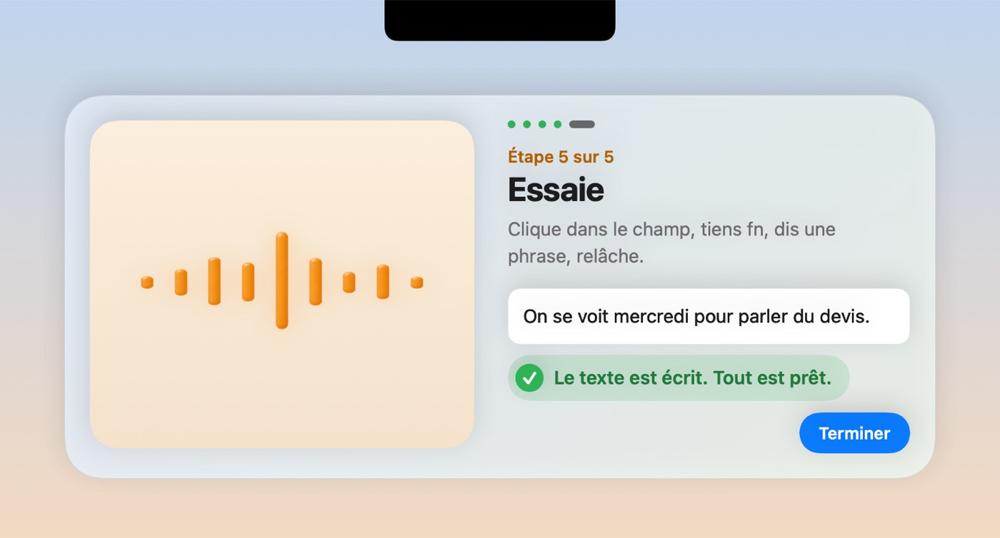

Clique dans le champ, tiens fn, dis une phrase, relâche. Quand le texte apparaît, la carte dit « Le texte est écrit. Tout est prêt. » Clique sur **Terminer**.

### Autres demandes de macOS, plus tard

Certaines fonctions demandent leur propre autorisation, au moment où tu les utilises. Tu peux toujours refuser : la fonction concernée ne marchera simplement pas.

| Quand | Ce que macOS demande |
|---|---|
| Premier texte en direct | La reconnaissance vocale (le texte en direct et le secours utilisent celle du Mac, sur l'appareil) |
| Première réunion notée | L'enregistrement du son du système (pour entendre les autres participants) |
| Allumer Calendrier | L'accès à tes calendriers |
| Envoyer un rappel dans Rappels | L'accès à Rappels |
| Envoyer une note dans Notes, ou brancher Mail | L'automatisation (Voxile pilote Notes ou Mail) |
| Allumer Téléchargements | L'accès au dossier Téléchargements |
| Batterie et appareils | Le Bluetooth |

**Revoir tes autorisations.** Clic droit sur l'icône de Voxile dans la barre des menus : les trois premières lignes montrent ✓ ou ✗ pour le micro, l'Accessibilité et la surveillance de l'entrée. **Autorisations…** ouvre le bon volet de Réglages Système. Tu les retrouves aussi dans Réglages › Compte › **Autorisations**.

---

## 4. Créer ta clé Groq (gratuite)

Groq est le service qui écrit ta voix en moins d'une seconde (modèle Whisper large v3 turbo). Il propose une offre gratuite : Voxile affiche ce qu'il te reste à dicter chaque jour.

1. Va sur [console.groq.com](https://console.groq.com) et crée un compte.
2. Ouvre la page **API Keys**, directement à l'adresse [console.groq.com/keys](https://console.groq.com/keys).
3. Crée une clé, donne-lui le nom que tu veux, et copie-la tout de suite.
4. Colle-la dans Voxile : à l'étape 4 de la prise en main, ou plus tard dans Réglages › Compte › **Clé Groq** › **Ajouter** (ou **Modifier**).

La clé est rangée dans le Trousseau de ton Mac, jamais dans un fichier.

Les noms exacts des boutons de la console Groq peuvent changer : cherche « API Keys » dans son menu.

**Les limites de l'offre gratuite.** Voxile les compte pour toi. Dans Réglages › Compte, une ligne dit par exemple « Il te reste 7 h 18 de dictée gratuite aujourd'hui », avec la limite : 8 h par jour, 2 h par heure au plus. Si la limite est atteinte, la dictée passe par le Mac (voir plus bas, « Si Groq ne répond pas »).

**Sans clé Groq.** La dictée d'Apple, faite sur le Mac, écrit à la place. Elle est un peu moins juste, et la remise au propre et les réunions ont besoin de Groq.

---

## 5. Dicter

| Geste | Effet |
|---|---|
| Tenir **fn**, parler, relâcher | Dicte, puis écrit au curseur |
| Deux appuis rapides sur **fn** | Mains libres : un nouvel appui sur fn, ou ✓, termine |
| **Échap** ou ✕ | Annule : rien n'est écrit |

Clique d'abord là où tu veux écrire. Le texte arrive environ 0,4 seconde après que tu as relâché fn.

### Tenir fn

Tiens fn, parle, relâche. Pendant que tu parles, l'encoche montre l'icône de l'app qui recevra le texte, ta voix, et le texte en direct. Au relâchement, la version finale, remise au propre, s'écrit.

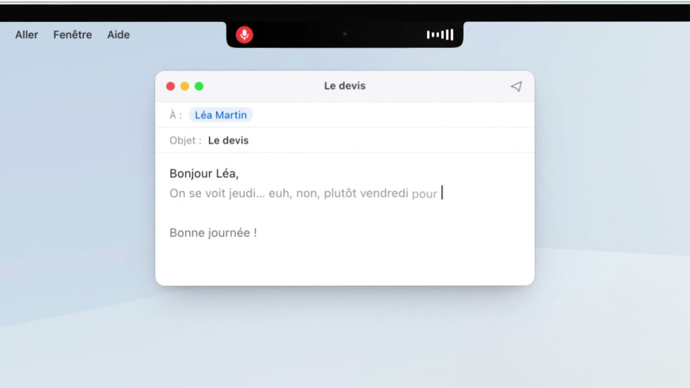

*En direct, Voxile affiche ce qu'il entend : « On se voit jeudi… euh, non, plutôt vendredi pour ».*

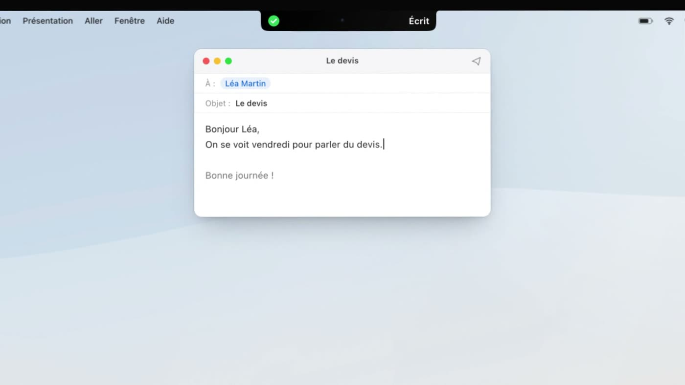

*Au relâchement, il écrit « On se voit vendredi pour parler du devis. » L'encoche dit « Écrit ».*

### Mains libres

Pour dicter longtemps sans tenir la touche : appuie **deux fois vite** sur fn. Voxile écoute jusqu'à ce que tu appuies de nouveau sur fn, ou sur **✓**.

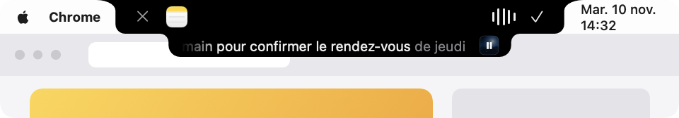

*En mains libres, ✕ (annuler) et ✓ (terminer) apparaissent de chaque côté de l'encoche. Le petit carré à droite du texte est une vidéo que Voxile a mise en pause pendant ta dictée : elle reprend à la fin.*

### Annuler

Appuie sur **Échap**, ou clique sur **✕**. Rien n'est écrit.

### Sons et vibration

Un petit son et une vibration du trackpad marquent le début, la fin (texte collé) et l'annulation. La vibration ne se sent que si un doigt est posé sur le trackpad. Réglages › Dictée › **Sons** et **Vibration** les coupent séparément.

### Ce que fait la remise au propre

Voxile ne colle pas le texte brut. Il le remet au propre :

- il ajoute la ponctuation ;
- il retire les hésitations (« euh ») ;
- il applique les corrections que tu dis à voix haute (« mardi, non plutôt mercredi » devient « mercredi ») ;
- il comprend quelques commandes dites : « à la ligne », « nouveau paragraphe », « point d'interrogation », « deux points », « virgule »…

Si la remise au propre est trop lente ou en erreur, Voxile garde le texte brut : tu ne perds jamais ta dictée.

Tu peux couper la remise au propre dans Réglages › Dictée › **Remettre au propre**.

### La forme du texte dépend de l'app

Voxile regarde où le texte va s'écrire et adapte la forme :

| Dans… | Voxile écrit… |
|---|---|
| Une barre d'adresse ou de recherche d'un navigateur | Une requête courte, sans point final |
| Le Terminal et les apps de programmation (iTerm, Warp, Ghostty, VS Code…) | Du texte brut sur une seule ligne, jamais d'Entrée (sinon la commande partirait toute seule) |
| Un mail (Mail, Outlook, Gmail…) | Des paragraphes soignés, des phrases complètes. Voxile n'ajoute ni formule de politesse ni objet |
| Une messagerie (Messages, WhatsApp, Slack, Discord, Telegram, Signal, Teams…) | Un ton direct, tel que tu l'as dit, en quelques lignes courtes |
| Une app de notes ou de documents (Notes, Pages, Word, Obsidian, Notion, TextEdit, Bear, Google Docs…) | Des paragraphes, et des listes à puces quand tu énumères |
| Un assistant IA (Claude, ChatGPT, Gemini…) | Ton texte fidèle, mot pour mot, rangé en paragraphes s'il est long |
| Toute autre app | Des phrases propres, des paragraphes si la dictée est longue |

L'interrupteur **Adapter le ton à l'app** (Réglages › Dictée) règle cet ajustement : « Plus soigné dans Mail, plus court dans WhatsApp ».

### Tes mots et tes raccourcis

Voxile apprend les noms qu'il doit bien écrire. Va dans Réglages › **Mots et raccourcis** :

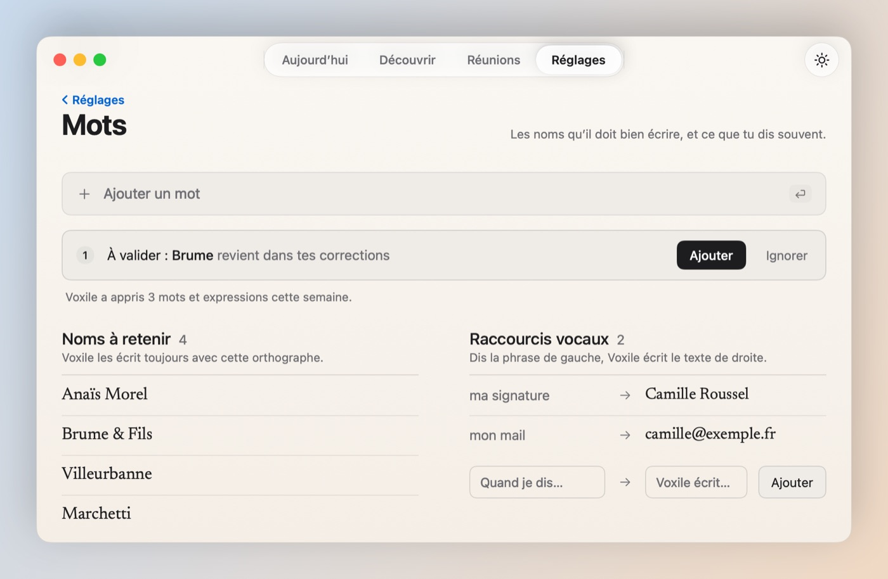

- **Noms à retenir** : les mots que Voxile écrit toujours avec cette orthographe (noms de personnes, d'entreprises, jargon). Écris-en un dans « Ajouter un mot » puis Entrée.
- **À valider** : quand tu corriges à la main un mot juste après une dictée, Voxile te propose de le retenir. **Ajouter** ou **Ignorer**.
- **Tes expressions** : ce que tu dis souvent, repéré tout seul dans tes dictées. Retire ce qui n'a rien à faire là.
- **Raccourcis vocaux** : tu dis la phrase de gauche, Voxile écrit le texte de droite. Par exemple, « ma signature » écrit ton nom complet.

### Si le texte n'arrive pas : le filet de sécurité

Si Voxile pense que le texte n'est pas arrivé dans l'app, il le garde et l'affiche sous l'encoche, avec deux boutons : **Coller ici** (Entrée) et **Copier** (⌘C). Tu ne perds rien.

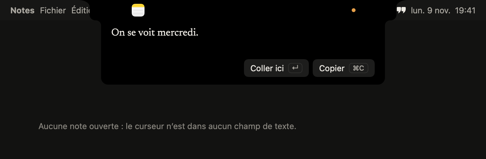

### Retrouver une ancienne dictée

Toutes tes dictées sont gardées sur ton Mac. Tu les retrouves de trois façons :

- clic gauche sur l'icône de Voxile dans la barre des menus : le panneau compact ;
- le Centre de l'encoche, bouton aux deux guillemets (« ) ;
- la fenêtre de Voxile, page **Dictées** (voir [la section 11](#11-la-fenêtre-de-voxile)).

Clique une dictée pour la recoller dans l'app d'avant, ou la copier. Dans la page Dictées : ⌘K cherche, ↑ ↓ choisissent, Entrée recolle, Espace déplie, ⌘C copie.

### Langue, micro, vitesse

Réglages › **Micro, langue, vitesse** :

- **Micro** : « Automatique » prend le micro du Mac quand un casque Bluetooth est branché. Tu peux en choisir un autre.
- **Langue** : Français, Anglais ou Automatique.
- **Vitesse** : « Rapide (turbo) » est le plus rapide. « Précis (large-v3) » est un peu plus lent et plus juste.
- **Secours** : « Apple » (la dictée du Mac prend le relais si Groq ne répond pas, c'est le réglage de départ) ou « Aucun ».

### Si Groq ne répond pas

Limite atteinte, pas de réseau, panne : Voxile passe par la dictée du Mac, et retente Groq à la dictée suivante. Si un VPN bloque Groq, Voxile le dit clairement.

---

## 6. L'encoche et le Centre

Sur un Mac avec encoche, Voxile vit dans l'encoche. **Survole-la** avec la souris : elle s'ouvre sur le **Centre**, qui réunit tout ce qui compte.

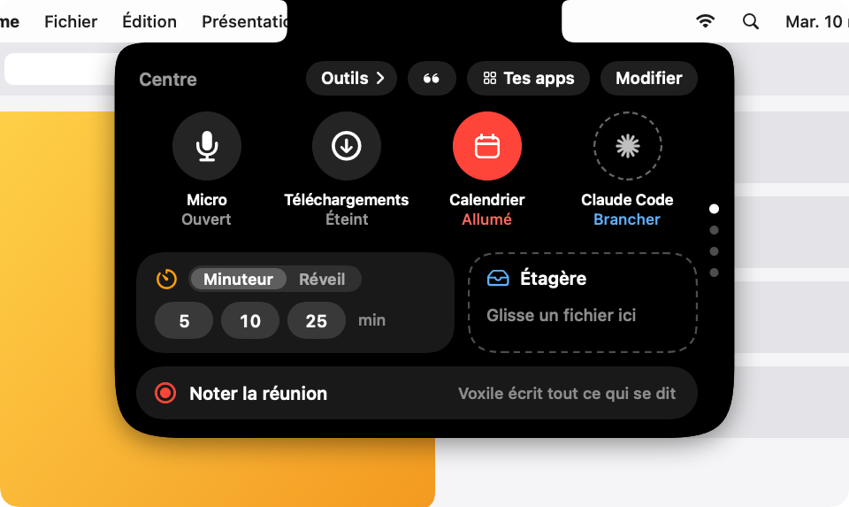

*Le Centre : en haut les boutons « Outils », celui aux deux guillemets (les dictées), « Tes apps » et « Modifier ». Au milieu les ronds Micro, Téléchargements, Calendrier et Claude Code. En bas le minuteur, l'étagère et « Noter la réunion ».*

**Se déplacer.** L'encoche ouverte est une pile de pages, montrées par des points à droite : le Centre, les Outils, l'accueil (rendez-vous, rappel, dernière dictée), puis les Dictées. On passe de l'une à l'autre en cliquant les boutons (« Outils › », « ‹ Centre »), ou en faisant défiler **deux doigts** sur le trackpad (un geste, une page). Le bouton **Reste ouvert** garde l'encoche ouverte.

**Modifier.** Comme sur l'iPhone : « – » retire un bouton, « Ajouter : » en haut en remet, tu ranges les boutons en les glissant, **OK** enregistre.

**Les ronds du Centre**

- **Micro** : coupe le micro du Mac, ou le rouvre. Micro coupé, **fn ne dicte pas** : Voxile te le dit et propose de le rouvrir. Voxile ne rouvre jamais le micro en cachette.
- **Téléchargements** : annonce un fichier qui vient d'arriver dans Téléchargements (AirDrop compris) avec un bouton **Ouvrir**. Éteint au départ : un clic l'allume, et macOS demande l'accès au dossier.
- **Calendrier** : annonce un rendez-vous 10 minutes avant et au début, avec **Rejoindre** (Meet, Zoom, Teams) et **Noter la réunion**. Éteint au départ : un clic l'allume, et macOS demande l'accès à tes calendriers.
- **Claude Code** : voir [la section 9](#9-claude-code-dans-lencoche).

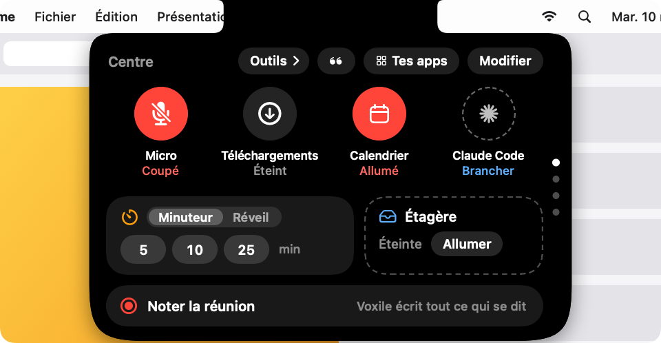

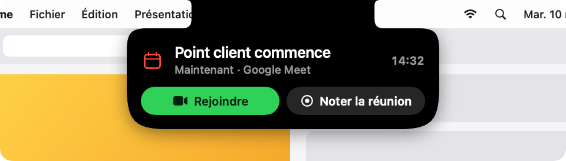

### Minuteur et réveil

Dans le Centre, la case **Minuteur** a deux onglets, Minuteur et Réveil.

- **Minuteur** : clique 5, 10 ou 25 min. Le compte à rebours part et reste visible dans l'encoche. Déplié, il montre la pause, ✕, **+ 1 min** et l'heure de fin.
- **Réveil** : clique 7:00, 8:00, 9:00 ou **Autre…** pour choisir une heure. Si le Mac dort à l'heure du réveil, il sonne dès qu'il se réveille.

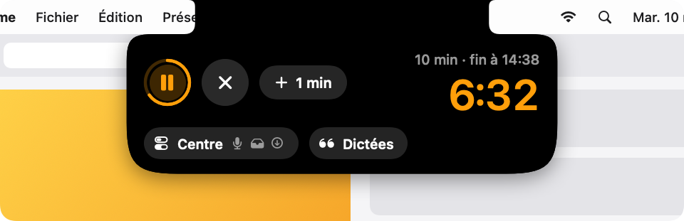

Le son de fin se choisit dans Réglages › **Son de fin du minuteur** (avec un bouton **Écouter**). Tu peux aussi les lancer à la voix (voir [la section 7](#7-commandes-à-la-voix)).

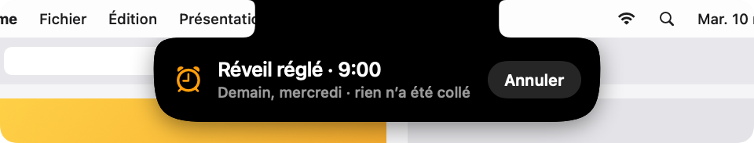

### L'étagère

Glisse un fichier (ou une capture d'écran) vers l'encoche : deux zones apparaissent.

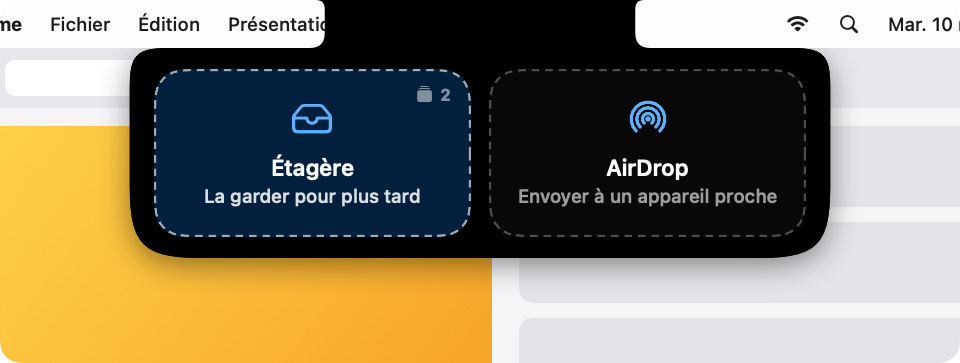

- **Étagère** : « La garder pour plus tard ». Le fichier reste sur l'étagère.
- **AirDrop** : « Envoyer à un appareil proche ».

Pour reprendre un fichier, ouvre le Centre et clique sur la case **Étagère**, puis glisse le fichier hors de l'encoche, dans un mail, un dossier, un chat. Voxile garde seulement un lien vers chaque fichier, jamais une copie : le fichier d'origine reste où il est, et s'il est supprimé, il quitte l'étagère.

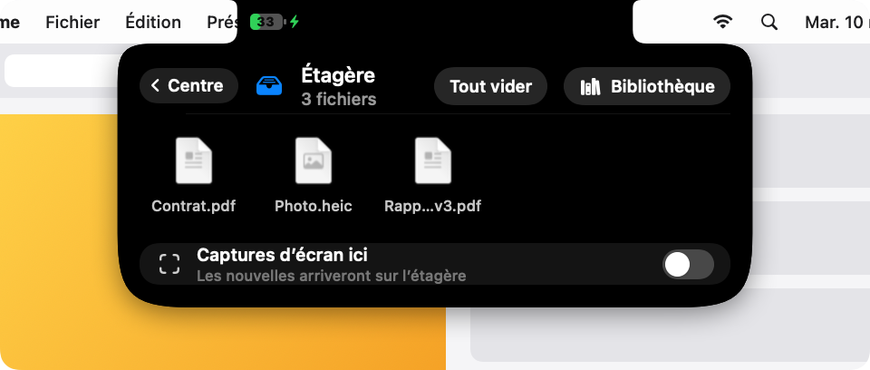

- **Tout vider** vide l'étagère (les fichiers ne sont pas supprimés).
- **Captures d'écran ici** : quand c'est allumé, les nouvelles captures d'écran arrivent sur l'étagère.
- **Bibliothèque** ouvre l'historique des fichiers dans la fenêtre de Voxile.

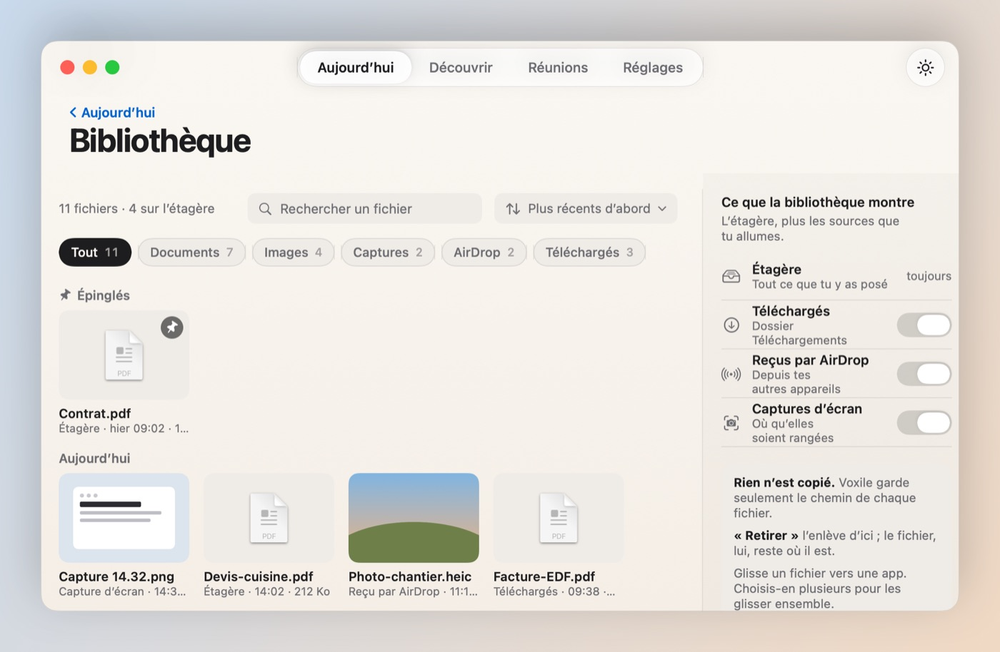

*La Bibliothèque garde l'historique (500 fichiers au plus) de l'étagère, et si tu les allumes, des fichiers téléchargés, reçus par AirDrop et des captures d'écran. « Retirer » l'enlève d'ici, le fichier reste où il est.*

L'étagère se coupe dans Réglages › **Ce qu'elle montre**.

### Les Outils

Clique sur **Outils ›** dans le Centre : une deuxième page, avec quatre outils et une bande « Dicter une note ».

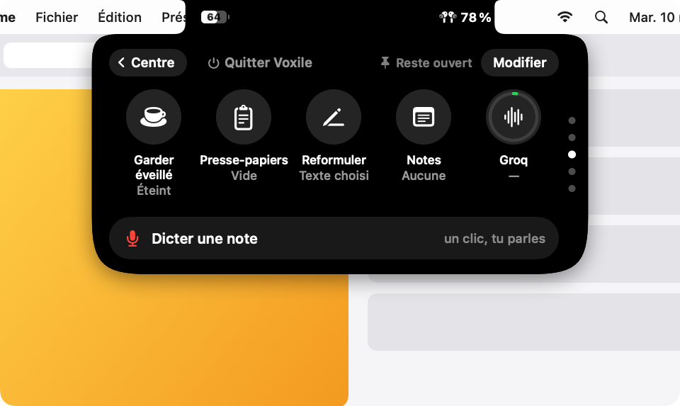

- **Garder éveillé** : empêche le Mac de s'endormir 1 h, 2 h, ou jusqu'à l'arrêt.
- **Presse-papiers** : les 5 derniers éléments copiés. **Coller** ou copier de nouveau. « Rien ne quitte ce Mac », et **Tout effacer** vide la liste.
- **Reformuler** : choisis la dernière dictée ou un texte, puis **Plus pro**, **Plus court** ou **En anglais**. **Remplacer** remet le texte reformulé à la place, **Copier** le copie. Ce texte passe par Groq, comme la remise au propre.
- **Notes** : **Dicter une note** (clique et parle, Voxile s'arrête quand tu te tais). Les notes sont gardées sur ton Mac, et un bouton les envoie dans l'app Notes.
- **Groq** : ce qui te reste à dicter aujourd'hui.

### Le reste de ce que montre l'encoche

Chaque élément s'allume ou s'éteint dans Réglages › **Ce qu'elle montre** :

- la **lecture en cours** (musique, vidéos : pochette, titre, commandes), mise en pause pendant la dictée si tu le veux, et relancée seulement si Voxile l'avait arrêtée ;
- la **batterie** du Mac et de tes AirPods, le chargeur branché ;
- le **volume** et la **luminosité** quand tu utilises les touches du clavier ;
- les **fichiers qui arrivent** (voir Téléchargements plus haut) ;
- les **notifications** des autres apps (réglage « expérimental », éteint au départ).

### L'îlot en verre, et où il se pose

Sur un écran sans encoche (écran externe, MacBook fermé), Voxile reste utilisable : l'icône de la barre des menus ne disparaît pas, et l'îlot devient une pilule de verre.

Tu peux aussi le déplacer : **appui long** (0,4 s) sur l'encoche, glisse, et lâche près d'un coin ou d'un bord. Il y a huit places aimantées. Proche de l'encoche, il y retourne. L'intensité du verre se règle dans Réglages › **Apparence**.

---

## 7. Commandes à la voix

Une dictée qui **commence par « Voxile »** est une commande, pas un texte. Elle n'est jamais collée dans l'app. Ça marche l'encoche ouverte ou fermée, dans n'importe quelle app. Sans le mot « Voxile » en tête, rien ne change : une phrase de ton mail ne devient jamais une commande.

| Tu dis | Voxile fait |
|---|---|
| « Voxile, minuteur 10 minutes » | Lance un minuteur de 10 minutes |
| « Voxile, réveille-moi à 9 h » | Règle un réveil à 9:00 |
| « Voxile, rappelle-moi demain à 9 h d'appeler le garage » | Prépare un rappel |
| « Voxile, note : montrer le prix dès la première page » | Prépare une note |

Les phrases peuvent varier : « mets un minuteur de 5 minutes », « prends une note »…

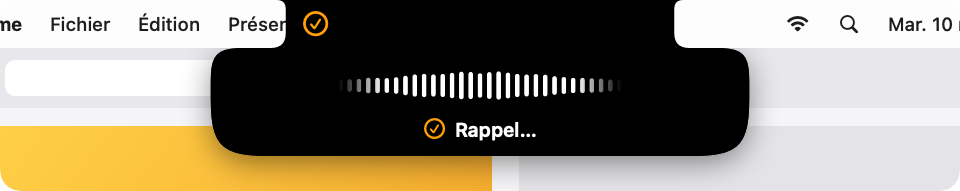

Tiens fn, dis ta phrase, relâche. Pendant que tu parles, une onde suit ta voix et dit « Rappel… » ou « Note… » dès que Voxile a compris.

### Un rappel

Au relâchement, une carte montre ce qui a été compris : le titre, le jour et l'heure.

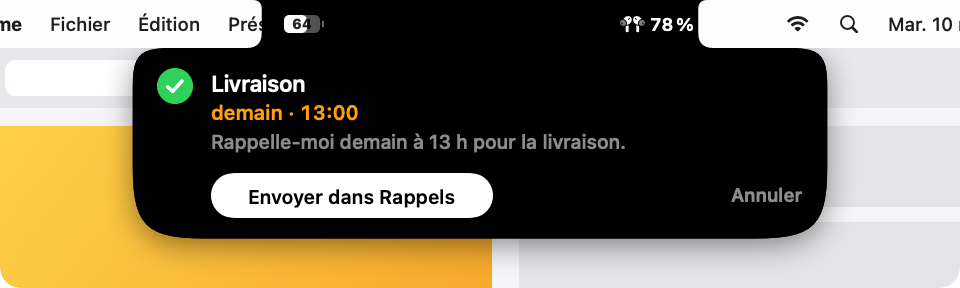

**Envoyer dans Rappels** l'ajoute dans l'app Rappels (il arrive alors sur ton iPhone). **Annuler** l'abandonne. Les rappels sont aussi gardés dans Voxile, sur ce Mac, et reviennent après un redémarrage. Voxile ne lit et ne change pas tes autres rappels.

Si tu ne dis pas l'heure, Voxile répond « Il me manque l'heure ». Si l'heure est déjà passée, il répond « Cette heure est passée » : dans les deux cas, rien n'est ajouté.

### Une note

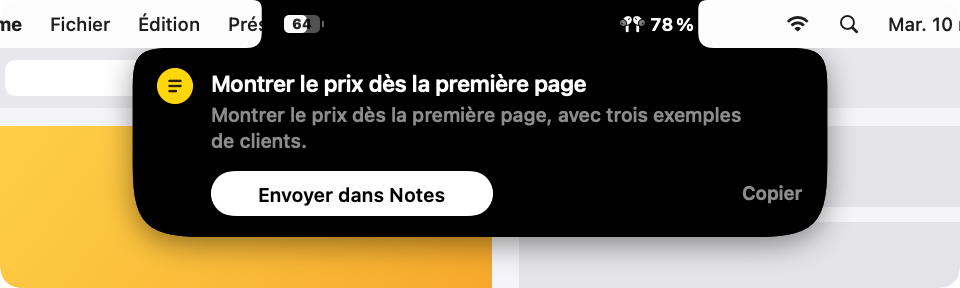

**Envoyer dans Notes** crée la note dans l'app Notes. **Copier** la copie.

### Si Voxile ne comprend pas

Il affiche « Je n'ai pas compris » avec ta phrase. Rien n'est collé. Redis-la un peu plus simplement.

---

## 8. Réunions

Voxile écrit tout ce qui se dit pendant une réunion ou un appel, sépare les voix, et fait une note par sujets. Il a besoin de ta clé Groq.

### Lancer une note

- **Voxile te propose** : quand Zoom, Teams, FaceTime, Skype, WhatsApp ou Aircall utilise le micro, une ligne apparaît : « Noter cet appel ? ». Pour Meet et les autres appels dans le navigateur, la proposition est la même mais plus discrète. **Rien ne s'enregistre sans ton clic.** Réglages › Réunions › **Proposer de noter les appels** la coupe.
- **Tu lances toi-même** : bouton **Noter la réunion** du Centre, ou clic droit sur l'icône de Voxile › **Noter la réunion**, ou le bouton de la carte du rendez-vous.

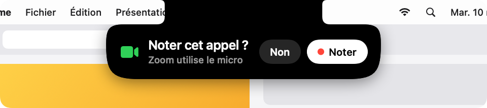

Au premier essai, macOS demande l'autorisation d'enregistrer le **son du système** : c'est ce qui permet d'entendre les autres participants. Voxile écoute ton micro et le son du Mac, **seulement** pendant que tu notes.

### Pendant la réunion

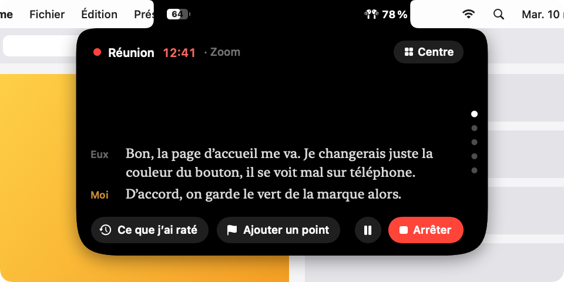

L'encoche montre un point rouge, le temps et les phrases au fur et à mesure (« Moi » pour toi, « Eux » pour les autres). Quatre boutons :

- **Ce que j'ai raté** : en deux ou trois puces, les 3 dernières minutes (si tu as décroché un instant).
- **Ajouter un point** : pose un repère à cet instant, qui se retrouvera dans la note.
- **Pause** (⏸) : suspend l'écoute.
- **Arrêter** : termine et lance l'écriture de la note.

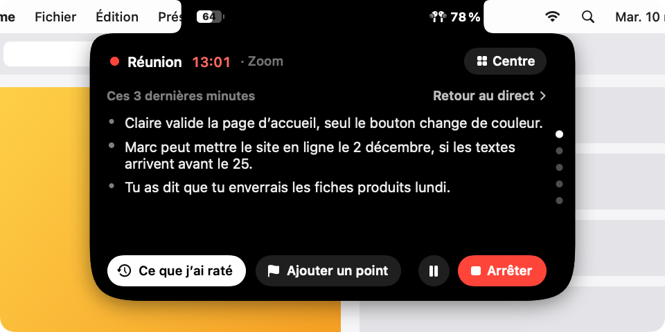

### Après

La note se prépare (« Note en préparation… »), puis l'encoche annonce « Note prête » avec **Ouvrir**.

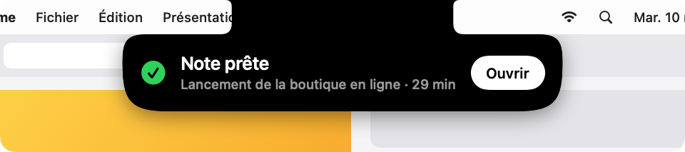

### La page Réunions

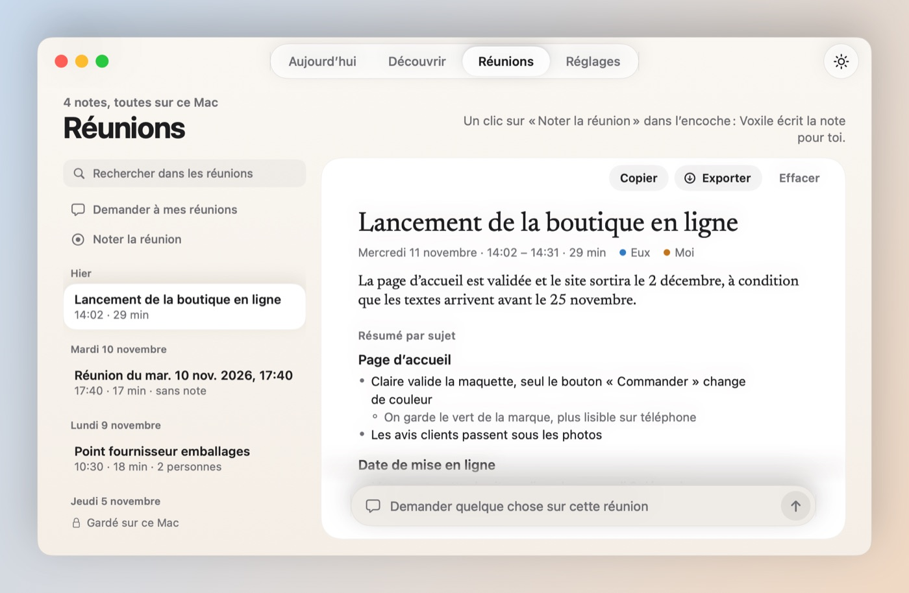

Elle liste tes notes par jour. Chaque note contient :

- une phrase d'ouverture, puis un **résumé par sujet** ;
- les **décisions** ;
- les **prochaines étapes**, avec qui doit faire quoi, et les échéances dites à voix haute ramenées à de vraies dates quand c'est précis (« jeudi », « avant le 20 novembre ») ;
- les voix séparées. Les participants s'appellent « Personne 1 », « Personne 2 »… tu peux les **renommer**.

En haut de la note :

- **Copier** copie la note ;
- **Exporter** l'enregistre en fichier Markdown ;
- **Effacer** la supprime (avec une confirmation) ;
- **Refaire la note** la reprend à zéro, utile si le réseau a manqué.

En bas, la barre **Demander quelque chose sur cette réunion** répond à une question sur la note (« qui a promis quoi », une date, un chiffre) et renvoie au passage exact. **Demander à mes réunions** (en haut à gauche) pose la question sur **toutes** tes notes. Pour répondre, seules les notes partent chez Groq, pas le son.

Une barre de recherche cherche dans toutes tes réunions.

### Le son

Réglages › Réunions › **Garder le son des réunions** : allumé (réglage de départ), le son reste à côté de la note, sur ce Mac. Chaque passage et toute la réunion se téléchargent (fichier .m4a). Éteint, le son est effacé dès que la note est prête.

---

## 9. Claude Code dans l'encoche

Si tu utilises Claude Code (l'outil de programmation d'Anthropic dans le Terminal), Voxile montre où il en est : tâches en cours (« 3 sur 7 »), « attend ta réponse », terminé.

### Le brancher

Une seule fois : Centre › rond **Claude Code** › **Brancher**, ou Réglages › **Ce qu'elle montre** › Claude au travail › **Brancher**.

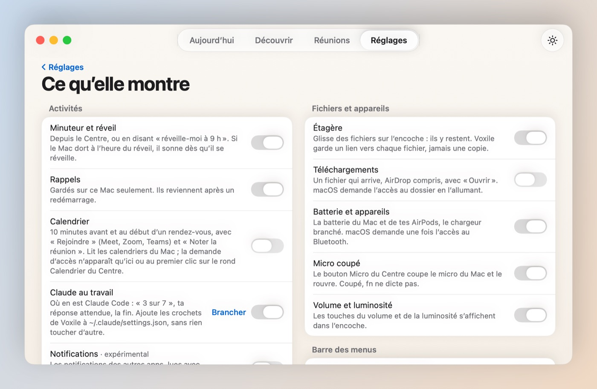

« Brancher » ajoute les crochets de Voxile au fichier `~/.claude/settings.json` de Claude Code, sans rien toucher d'autre. Les sessions de Claude Code ouvertes **après** ce branchement s'affichent dans l'encoche. **Débrancher** retire seulement les crochets de Voxile.

### Ce que tu vois

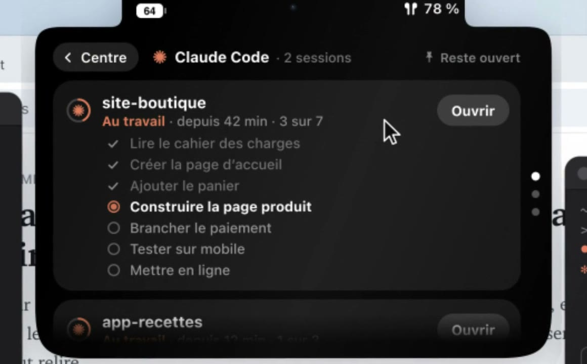

*Chaque session montre son projet, depuis combien de temps elle travaille et la liste de ses tâches. Les noms ici sont des exemples.*

- Dans l'encoche repliée, un petit compteur (« 3/7 »).
- Quand Claude Code te pose une question, l'encoche l'annonce (« … attend ta réponse »).
- À la fin d'une tâche, un bandeau dit « terminé ».
- **Ouvrir** ramène devant toi la bonne fenêtre du Terminal.

---

## 10. Tes apps

« Tes apps » branche tes outils : leurs nouveautés sortent de l'encoche en direct, et l'onglet **Nouveautés** les garde, rangées par app.

**Tout est en lecture seule.** Voxile ne peut rien écrire, rien modifier, rien envoyer dans tes apps.

Ouvre-les ainsi : Centre › **Tes apps**. Deux onglets : **Au quotidien** (Mail, Agenda, Notion, Airtable) et **Vente** (Shopify, HubSpot, Stripe).

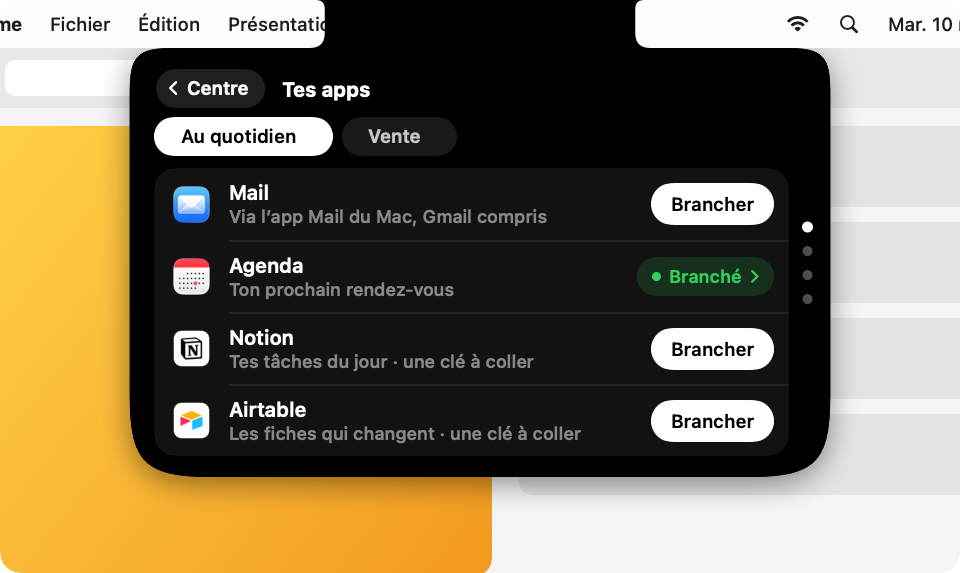

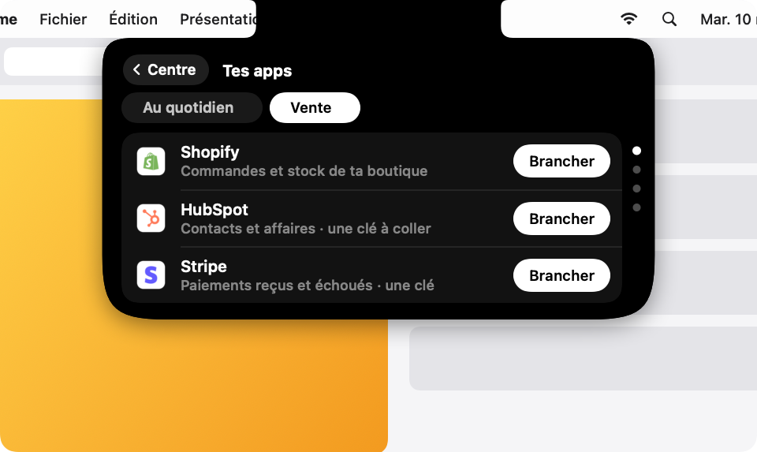

À chaque app, clique **Brancher** et suis les étapes de la carte. Quand elle a besoin d'une clé, le bouton **Ouvrir la page** ouvre dans ton navigateur la page où la créer, et **Coller** colle ce que tu viens de copier. La clé s'affiche masquée (« ntn_••••••••k7Rm »).

| App | Ce qui est annoncé | Ce qu'il faut |
|---|---|---|
| Mail | Les nouveaux mails (expéditeur et objet, jamais le contenu) | Autoriser Voxile à contrôler Mail |
| Agenda | Le prochain rendez-vous, avec « Rejoindre » | L'accès au calendrier |
| Notion | Les tâches d'une base qui te sont assignées ou du jour | Une clé de connexion interne (`ntn_…`), et la base partagée avec cette connexion |
| Airtable | Les nouvelles lignes d'une table | Un jeton avec `data.records:read` et `schema.bases:read` |
| Shopify | Nouvelle commande, commande payée, stock bas | Une app du Dev Dashboard : adresse de la boutique, Client ID, Client secret |
| HubSpot | Nouveau contact, affaire qui change d'étape, gagnée ou perdue | Une clé de service (`pat-…`), droits contacts et affaires en lecture |
| Stripe | Paiement reçu, paiement échoué | Une clé limitée (`rk_…`) en lecture ; une clé `sk_…` est refusée |

**Une clé, c'est quoi ?** Un long mot de passe qu'une app te donne pour qu'une autre app (ici Voxile) puisse la consulter. Voxile la range dans le **Trousseau** du Mac, jamais dans un fichier, jamais dans son journal. Le bouton **Débrancher** l'efface de ce Mac. Pour être tranquille, crée toujours des clés **en lecture seule**.

> Les sites de Notion, Airtable, Shopify, HubSpot et Stripe changent souvent leurs menus. Les chemins ci-dessous sont ceux que Voxile indique dans l'app et ceux que ces services donnaient au moment de l'écriture de ce manuel. Si un menu a bougé, cherche le mot clé en gras (« Clés de service », « clé limitée », etc.).

### Mail

Mail se branche sans clé : Voxile lit tes mails par l'app Mail du Mac, Gmail compris (si ton compte Gmail est dans Mail).

1. Centre › Tes apps › **Mail** › **Brancher**.
2. macOS demande si Voxile peut contrôler Mail : accepte.
3. Si tu as refusé : Réglages Système › Confidentialité et sécurité › **Automatisation**, et autorise Voxile à contrôler Mail. Dans l'encoche, le bouton **Ouvrir les Réglages** t'y emmène.

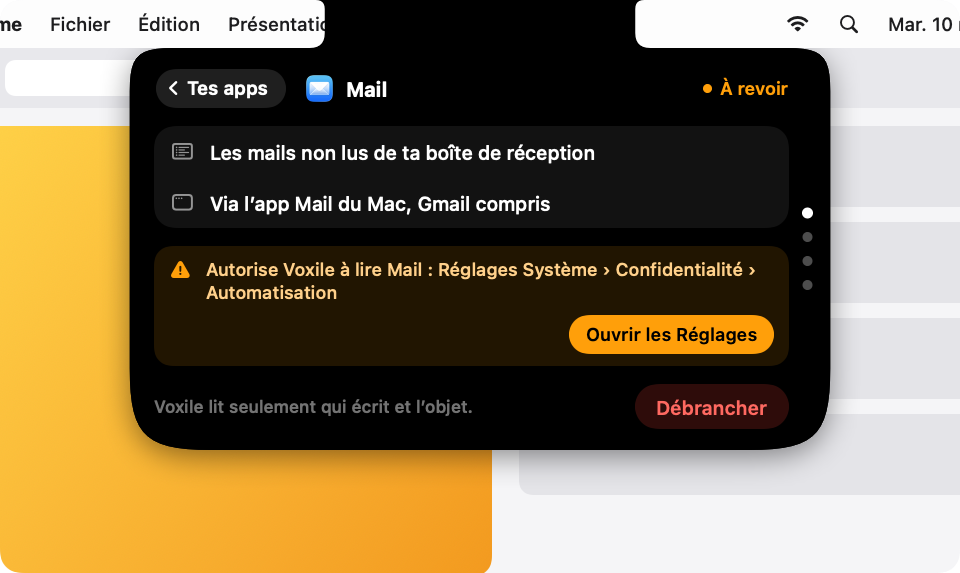

Voxile lit seulement **qui écrit et l'objet** de tes mails non lus de la boîte de réception, jamais leur contenu. **Mail doit être ouvert** : s'il est fermé, Voxile le dit (« Mail est fermé : rien n'est lu ») et se met en pause.

### Agenda

Agenda se branche sans clé non plus : il lit le Calendrier du Mac, Google Agenda compris (si ton compte est dans Calendrier).

1. Centre › Tes apps › **Agenda** › **Brancher**.
2. macOS demande l'accès à tes calendriers : accepte.

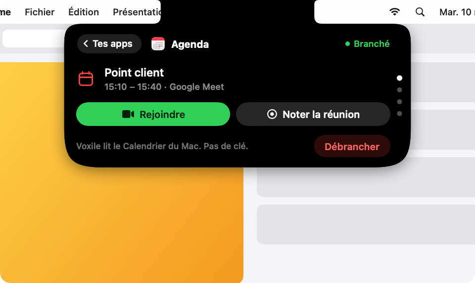

Voxile montre ton prochain rendez-vous, avec **Rejoindre** (Meet, Zoom, Teams) et **Noter la réunion**. S'il n'y a rien dans les 12 heures qui viennent, il dit « Rien d'ici 12 h dans ton calendrier ».

### Notion

Voxile suit **une base** que tu choisis : les tâches du jour (la date de la tâche est aujourd'hui) et celles qui te sont assignées. La base doit donc avoir une propriété date, une propriété personne, ou les deux. Sinon Voxile te dit « Cette base n'a ni date ni personne » et te laisse en choisir une autre.

1. Centre › Tes apps › **Notion** › **Brancher**.
2. Clique **Ouvrir la page** : elle ouvre `notion.so/profile/integrations`. C'est la liste de tes **connexions** (aussi appelées intégrations). Si tu n'en as pas encore, crée-en une, de type **interne**, dans l'espace de travail où se trouve ta base.
3. Ouvre ta connexion et copie sa **clé** (elle commence par `ntn_`).
4. **Partage ta base avec la connexion.** Dans Notion, ouvre la base, puis ajoute ta connexion à cette base (le nom du menu change selon la version de Notion : cherche « Connexions »). Sans ça, Voxile ne verra pas la base et affichera « Base pas partagée avec la connexion ».
5. De retour dans Voxile, clique **Coller**, puis **Vérifier la clé**. Une ligne verte dit « Clé valide » avec le nom de ton espace.
6. Choisis la base : **Suivre cette base**.
7. Si la base a une propriété personne, Voxile demande « Qui es-tu dans Notion ? ». Choisis ton nom puis **Suivre mes tâches**, ou **Passer**.

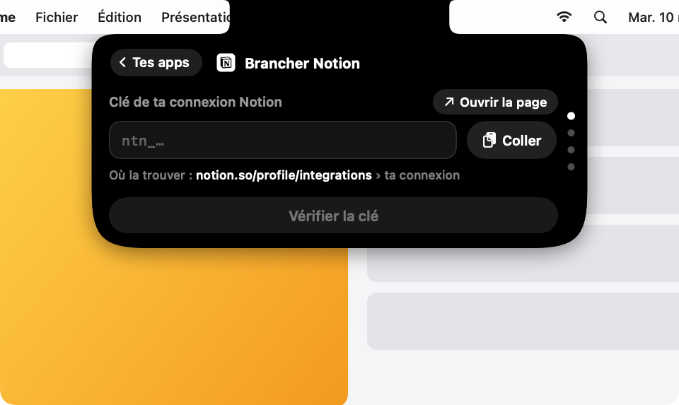

Changer de base plus tard : ouvre Notion dans « Tes apps » puis **Changer**.

### Airtable

Voxile suit **une table** et annonce les fiches qui changent.

1. Centre › Tes apps › **Airtable** › **Brancher**.
2. Clique **Ouvrir la page** : elle ouvre `airtable.com/create/tokens`.
3. Clique **Create new token**. Donne un nom.
4. Choisis les droits (« scopes »), en **lecture seule** : `data.records:read` et `schema.bases:read`.
5. Clique **add a base** et choisis la ou les bases que Voxile pourra voir.
6. Crée le jeton et **copie-le tout de suite** : Airtable ne le montre qu'une fois (il commence par `pat`).
7. Dans Voxile : **Coller**, puis **Vérifier le jeton**. Choisis la base, puis la table : **Suivre cette table**.

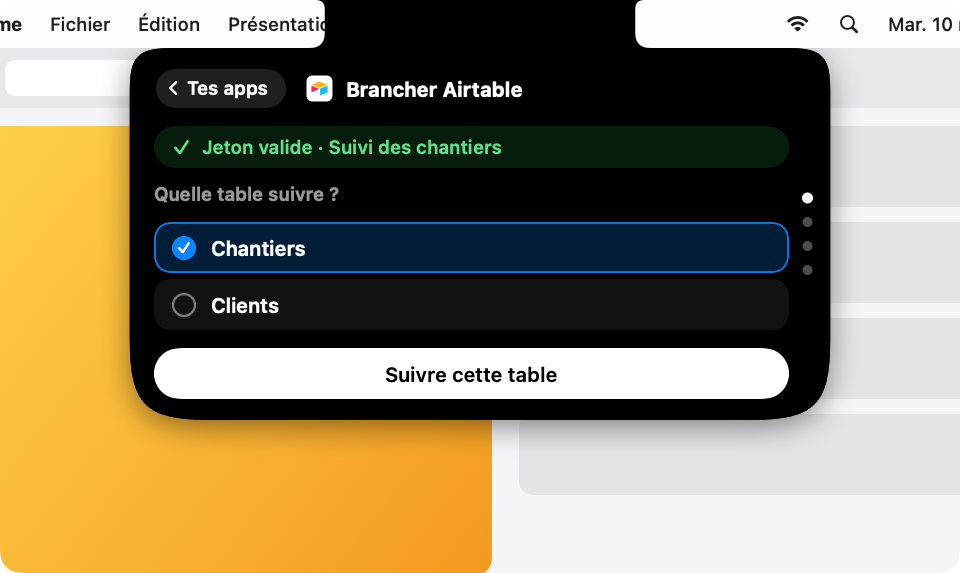

Si le jeton n'a pas les bons droits, Voxile dit « Il manque un droit à la clé Airtable » avec le nom du droit. Crée un jeton complet et clique **Coller une autre clé**.

### Shopify

Voxile annonce une nouvelle commande, une commande payée (numéro et montant) et un stock bas (3 pièces ou moins). Jamais un client : ni son nom, ni son mail, ni son adresse ne sont lus.

Depuis le 1er janvier 2026, Shopify ne permet plus de créer d'app « personnalisée » dans l'admin de la boutique. Il faut passer par le **Dev Dashboard** :

1. Dans l'admin de ta boutique : Réglages › Apps › Développer des apps › **Build apps in Dev Dashboard** (la page `dev.shopify.com/dashboard`, que le bouton **Ouvrir la page** ouvre aussi).
2. Crée une app. Donne-lui le droit **`read_orders`** (et **`read_products`** si tu veux les alertes de stock bas : facultatif).
3. **Installe l'app sur ta boutique.**
4. Dans les **Settings** de l'app, copie le **Client ID** et le **Client secret**.
5. Retrouve l'adresse de ta boutique : dans l'admin, Réglages › **Domaines**, l'adresse en `.myshopify.com`.
6. Dans Voxile : Tes apps › onglet Vente › **Shopify** › **Brancher**. Il y a trois champs, un par carte :
   1. l'**adresse de ta boutique** (`ma-boutique.myshopify.com`) puis **Continuer** ;
   2. l'**identifiant client** (Client ID) puis **Continuer** ;
   3. le **secret client** (Client secret) puis **Vérifier et brancher**.

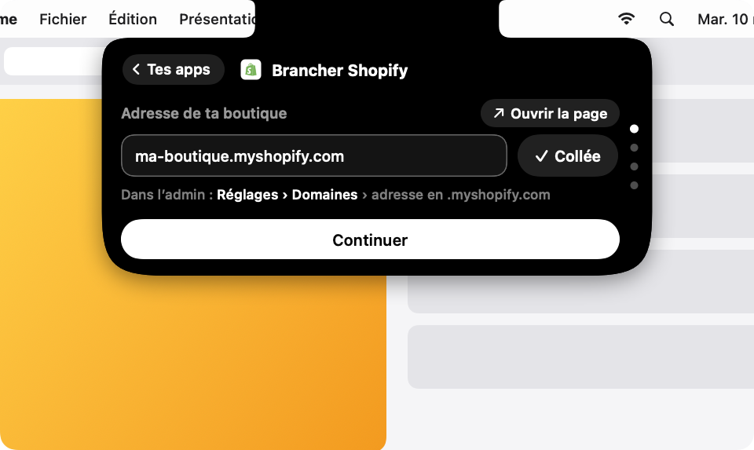

À savoir :

- L'app Dev Dashboard et la boutique doivent être dans **la même organisation Shopify**. Sinon Voxile dit « la boutique n'est pas dans ton organisation Shopify ».
- Si tu as une **ancienne app** (créée avant 2026), son jeton `shpat_…` fonctionne tel quel : colle-le à l'étape de l'identifiant et c'est fini, pas de secret à donner.
- Voxile utilise ton identifiant et ton secret pour obtenir un jeton valable 24 heures, qu'il garde seulement en mémoire.
- « Installe d'abord l'app sur ta boutique » veut dire que l'étape 3 manque.

### HubSpot

Voxile annonce les nouveaux contacts et les affaires qui changent d'étape (gagnée, perdue, ou une autre étape).

HubSpot ne permet plus de créer de « private app » depuis le 26 octobre 2026. Le chemin sans outil de développeur est une **clé de service** :

1. Dans HubSpot : **Développement › Clés › Clés de service**, puis **Créer une clé de service**. Le bouton **Ouvrir la page** ouvre la documentation de HubSpot sur ces clés.
2. Donne-lui les droits **`crm.objects.contacts.read`** et **`crm.objects.deals.read`** (lecture des contacts et des affaires, rien d'autre).
3. Copie la clé : elle commence par `pat-`.
4. Dans Voxile : Tes apps › onglet Vente › **HubSpot** › **Brancher** › **Coller** › **Vérifier la clé**.

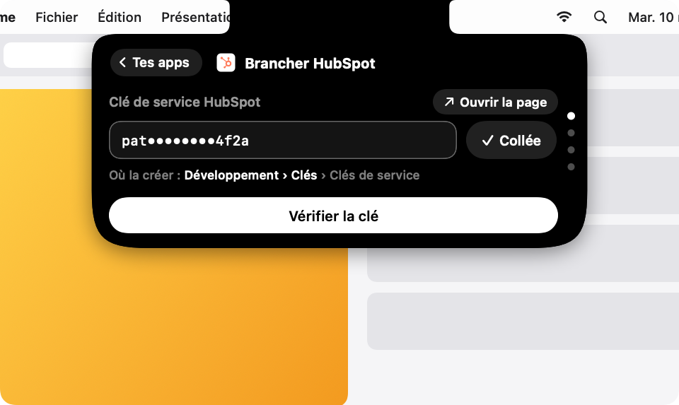

Si tu as une ancienne private app, son jeton `pat-…` marche encore. Si un droit manque, Voxile dit « Il manque un droit à la clé HubSpot » avec le nom du droit.

### Stripe

Voxile annonce un paiement reçu ou un paiement échoué.

1. Ouvre [dashboard.stripe.com/apikeys](https://dashboard.stripe.com/apikeys) (le bouton **Ouvrir la page** le fait).
2. Clique **Créer une clé limitée** (Développeurs › Clés API).
3. Donne seulement la lecture sur **Events** et **PaymentIntents**. Rien d'autre.
4. Copie la clé : elle commence par `rk_live_` (réel) ou `rk_test_` (mode test).
5. Dans Voxile : Tes apps › onglet Vente › **Stripe** › **Brancher** › **Coller** › **Vérifier la clé**.

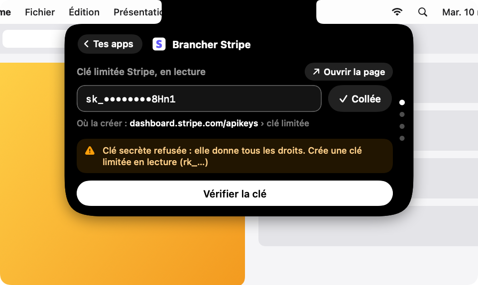

**Voxile refuse une clé secrète `sk_…`.** Elle donne tous les droits sur ton compte (rembourser, virer de l'argent). Voxile n'en a pas besoin, et dit « Clé secrète refusée : elle donne tous les droits. Crée une clé limitée en lecture (rk_…) ». Avec une clé `rk_test_…`, Voxile suit les paiements du mode test (le détail affiche « Mode : test »).

### Les nouveautés

Quand quelque chose arrive, un bandeau sort de l'encoche. Si plusieurs nouveautés arrivent ensemble, elles sont regroupées dans **une seule annonce** (par exemple « 4 nouveautés · 1 commande, 1 contact, 2 paiements »), jamais une rafale de bandeaux.

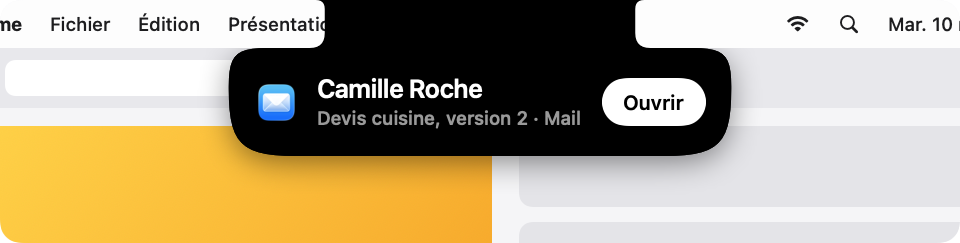

L'onglet **Nouveautés** (bouton en haut de « Tes apps ») garde tout, rangé par app. **Ouvrir** ouvre l'élément dans l'app (le mail dans Mail, la page dans Notion, la commande dans Shopify…). **Tout marquer lu** vide les pastilles.

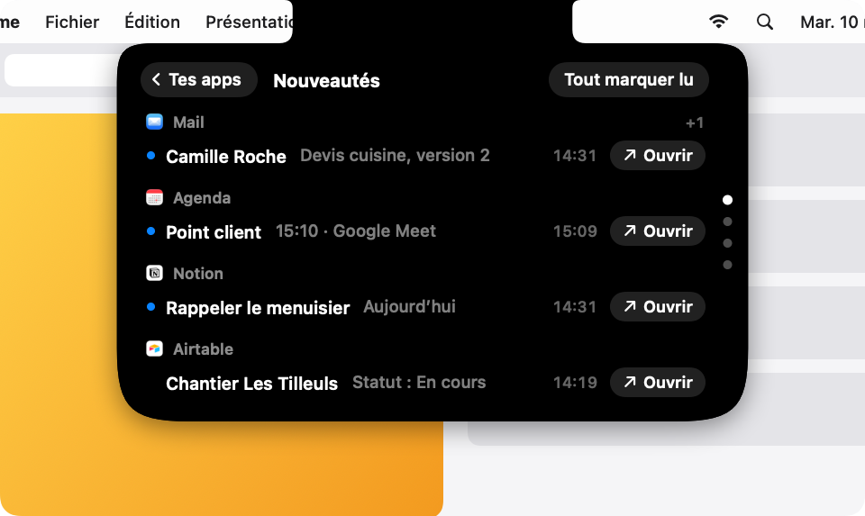

### Voir l'état d'une app, la débrancher

Clique sur une app branchée pour ouvrir son détail : ce qu'elle suit, la base ou la table suivie (avec **Changer**), la clé masquée, et **Débrancher**.

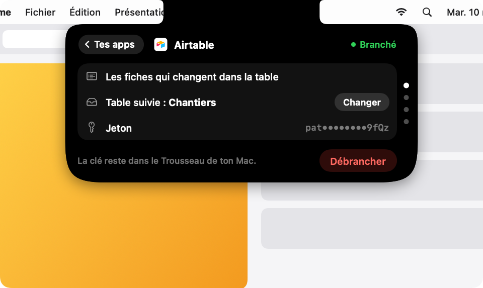

**Débrancher** demande une confirmation. Pour une app à clé : les nouveautés s'arrêtent et **la clé est effacée de ce Mac**. Tu peux rebrancher quand tu veux.

### Quand une app est « À revoir »

L'app affiche en ambre ce qui ne va pas, avec un bouton pour le réparer :

| Voxile dit | Ce que ça veut dire | Le geste |
|---|---|---|
| Clé à coller | Il n'y a pas de clé | Coller une clé |
| Clé refusée | L'app refuse la clé : vérifie qu'elle est complète | Coller une autre clé |
| Il manque un droit à la clé | La clé est bonne mais n'a pas tous les droits | Créer une clé avec les bons droits |
| Base pas partagée avec la connexion | Notion ne voit pas ta base | Dans Notion, ajouter la connexion à la base, puis **Choisir la base** |
| Boutique introuvable | L'adresse Shopify est fausse | Revérifier l'adresse en `.myshopify.com` |
| Clé à tous les droits : à remplacer | Une clé trop puissante (Stripe `sk_…`) | Créer une clé limitée en lecture |
| Demande de patienter | Le service demande d'attendre quelques secondes | **Réessayer** |
| Ne répond pas en ce moment, Pas de réseau | Panne ou réseau coupé | **Réessayer** |
| Autorisation à donner dans Réglages | macOS refuse à Voxile de piloter Mail | **Ouvrir les Réglages** |
| Mail est fermé | Voxile attend que tu ouvres Mail | Rien à faire |

---

## 11. La fenêtre de Voxile

Voxile vit dans l'encoche, mais il a aussi une vraie fenêtre. Ouvre-la en cliquant l'icône de Voxile dans le Dock, ou depuis Applications, Spotlight, Launchpad, ou clic droit sur l'icône de la barre des menus › **Ouvrir Voxile**. Elle apparaît dans le Dock tant qu'elle est ouverte.

Quatre onglets en haut : **Aujourd'hui**, **Découvrir**, **Réunions**, **Réglages**. Le bouton soleil/lune, en haut à droite, passe du clair au sombre.

### Aujourd'hui

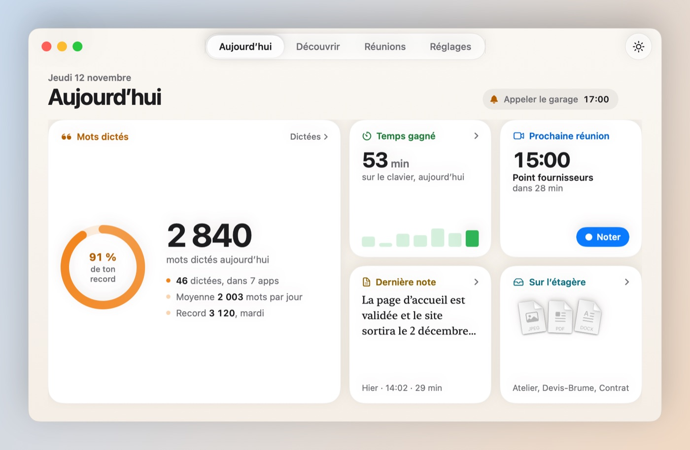

Le résumé de ta journée : les **mots dictés** (avec ton record), le **temps gagné** sur le clavier, ta **prochaine réunion** avec un bouton **Noter**, ta **dernière note**, et ce qu'il y a **sur l'étagère**. Chaque tuile à flèche ouvre une page :

- **Dictées** : toutes tes dictées, gardées sur ce Mac.
- **Temps gagné** ouvre « Ta journée » : le détail heure par heure. Le temps gagné se calcule ainsi : mots ÷ 40 par minute (une vitesse de frappe moyenne), moins ton temps de parole.
- **Étagère** ouvre la Bibliothèque.

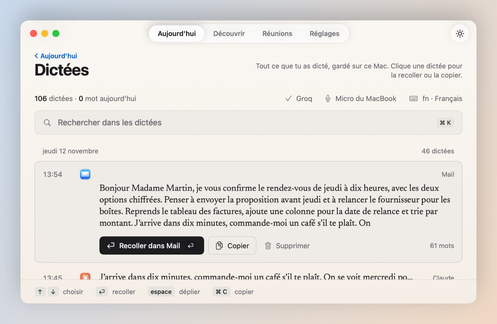

### Découvrir

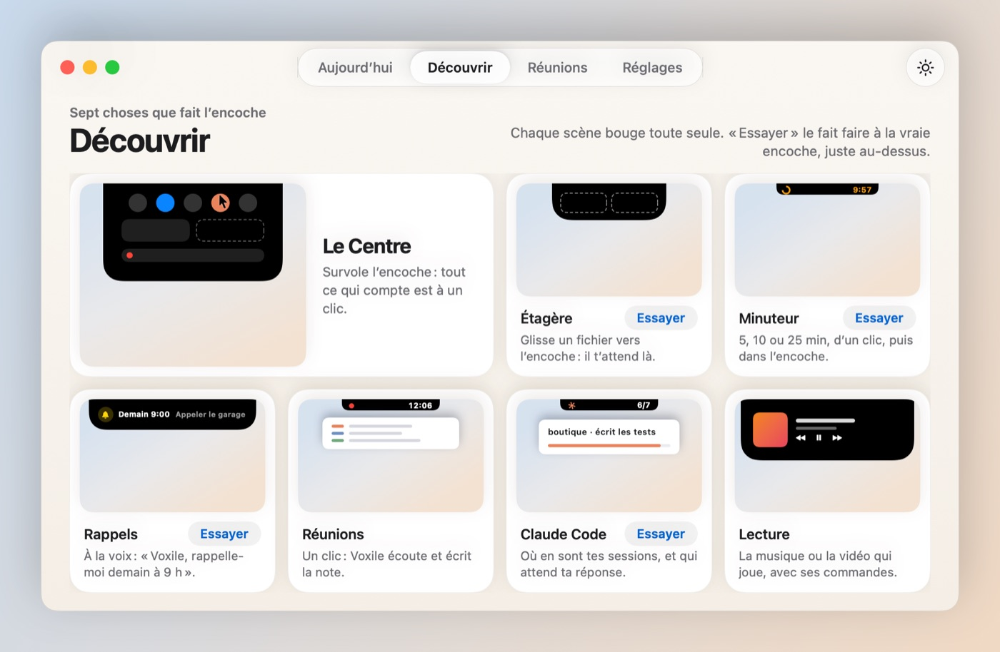

Sept choses que fait l'encoche : le Centre, l'Étagère, le Minuteur, les Rappels, les Réunions, Claude Code, la Lecture. Chaque scène bouge toute seule. **Essayer** le fait faire à la vraie encoche, juste au-dessus.

### Réunions

Voir [la section 8](#8-réunions).

---

## 12. Les réglages

Réglages est en cinq groupes. Une ligne avec une flèche ouvre une sous-page.

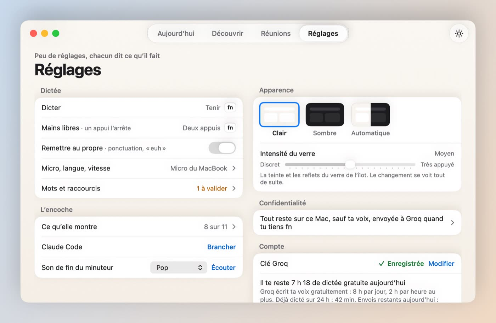

- **Dictée** : tes gestes (tenir fn, deux appuis), **Remettre au propre**, la touche 🌐 (une ligne apparaît si elle n'est pas réglée), **Micro, langue, vitesse**, **Mots et raccourcis**.
- **L'encoche** : **Ce qu'elle montre**, **Claude Code**, **Son de fin du minuteur**.
- **Apparence** : Clair, Sombre ou Automatique, et l'**intensité du verre** de l'îlot, du discret au très appuyé (le changement se voit tout de suite).
- **Confidentialité** : ce qui part et ce qui reste (voir plus bas).
- **Compte** : **Clé Groq**, ce qu'il te reste à dicter, **Autorisations** (« 3 sur 3 »), **Ouvrir au démarrage**, **Mises à jour**.

Et en bas : **Revoir la prise en main**, **Ouvrir le journal**, **Désinstaller Voxile**, **Quitter Voxile**.

### Dictée

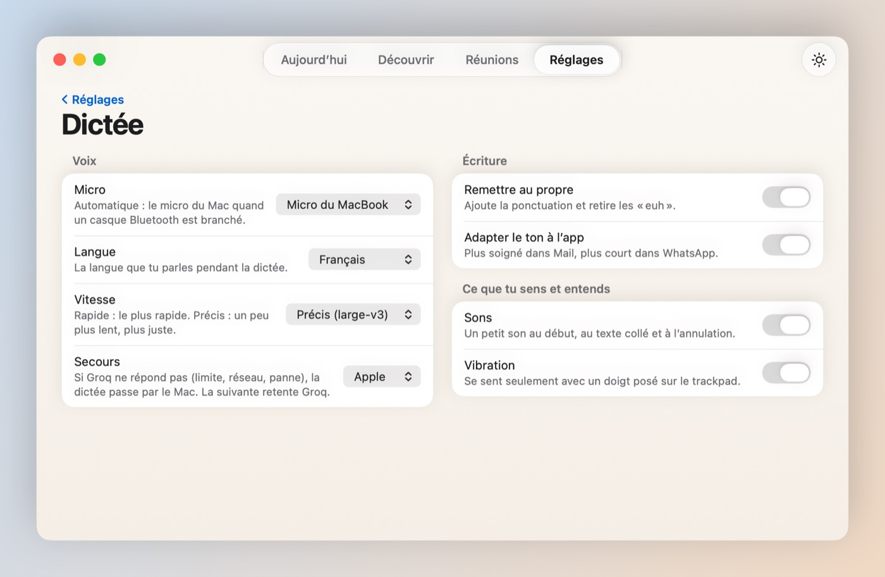

Micro, langue, vitesse, secours (voir [la section 5](#5-dicter)), remise au propre, adaptation du ton à l'app, sons, vibration.

### Ce qu'elle montre

C'est la liste des fonctions de l'encoche, avec un interrupteur pour chacune :

- **Minuteur et réveil**, **Rappels**, **Calendrier** (éteint au départ), **Claude au travail** (avec son bouton **Brancher**), **Notifications** (expérimental, éteint au départ).
- **Lecture en cours** et **Pause pendant la dictée**.
- **Étagère** (et **Captures d'écran ici**, dans la carte de l'étagère), **Téléchargements** (éteint au départ), **Batterie et appareils**, **Micro coupé**, **Volume et luminosité**.
- **Icône dans la barre des menus** : tu peux l'éteindre, tout se fait alors depuis l'encoche. Sans encoche (écran externe), l'icône reste.

### Confidentialité

La page dit ce qui part et ce qui reste :

- **Ta voix** : envoyée à Groq seulement quand tu tiens fn, ou pendant une réunion que tu notes, pour l'écrire. Rien d'autre ne quitte le Mac.
- **Tes dictées, tes notes, tes mots** : gardés sur ce Mac, dans ton dossier. Jamais envoyés ailleurs.
- **Le journal** : au plus 30 caractères de chaque dictée, pour comprendre une panne. Le bouton **Ouvrir** le montre.

Tu y trouves aussi la gestion de l'**historique** (**Effacer…** supprime toutes les dictées, ça ne se récupère pas), les réglages des **réunions**, et un **test de précision** facultatif (il garde sur ce Mac le son des 50 prochaines dictées pour comparer les modèles, et s'arrête tout seul).

### Ouvrir au démarrage

Un interrupteur dans Réglages › Compte. Il est éteint au départ.

---

## 13. Mises à jour

Voxile se met à jour tout seul. Une fois par jour, il demande à GitHub s'il existe une version plus récente. Si oui, une ligne apparaît **sous l'encoche** avec trois boutons :

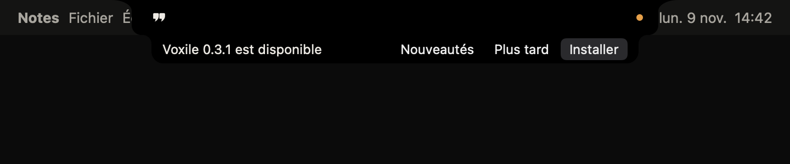

*Le numéro de version est un exemple.*

- **Installer** : Voxile télécharge le fichier, contrôle sa taille, son empreinte (SHA-256) et sa signature, remplace l'app puis se relance. Si une étape échoue, rien n'est remplacé.
- **Plus tard** : repousse la proposition au lendemain.
- **Nouveautés** : montre les notes de la version.

La proposition n'arrive **jamais pendant une dictée ni pendant une réunion**.

Dans Réglages › Compte › **Mises à jour**, tu vois ta version, un bouton **Rechercher**, et l'interrupteur **Vérifier automatiquement**. Le menu de l'icône de la barre des menus propose aussi **Rechercher les mises à jour…**.

Si tu as une version plus ancienne que la 0.3, il faut retélécharger le fichier une fois depuis la [page des versions](https://github.com/proladislas-rgb/dictee-mac/releases/latest).

---

## 14. Si tu venais de Verbe

Voxile s'appelait **Verbe** (et **Dictée** au tout début). Le nom a changé, pas ce qui compte : Voxile garde le même identifiant, donc tes **autorisations, ton historique et ton dictionnaire sont conservés**.

- Une Verbe installée qui se met à jour devient Voxile toute seule.
- À la main : quitte Verbe, glisse Voxile dans Applications et ouvre-la. Elle met l'ancienne `Verbe.app` à la corbeille.

Les dossiers internes gardent l'ancien nom `Dictee`, pour que rien ne se perde. Ton dictionnaire est dans `~/Library/Application Support/Dictee/mots.txt`, un mot par ligne, et le journal dans `~/Library/Logs/Dictee/dictee.log`.

---

## 15. Désinstaller

Clic droit sur l'icône de Voxile dans la barre des menus › **Désinstaller Voxile…**, ou Réglages › **Désinstaller Voxile**.

Voxile efface l'historique, les mots, les raccourcis, le journal, les réglages, la clé Groq et les clés de tes apps rangées dans le Trousseau, puis place l'app à la corbeille. Une éventuelle ancienne `Dictee.app` part aussi, après ta confirmation.

Un fichier de clé que tu aurais créé toi-même (`~/.config/groq/.env`) n'est jamais touché.

Pour tout effacer proprement, passe par **Désinstaller** plutôt que de glisser l'app à la corbeille.

---

## 16. Questions fréquentes et dépannage

### Rien ne s'écrit quand je dicte

1. **Regarde sous l'encoche.** Si le texte y est affiché avec **Coller ici** et **Copier**, Voxile l'a gardé : clique sur **Coller ici** (Entrée) ou **Copier**.
2. Clic droit sur l'icône de Voxile : les trois premières lignes doivent être en ✓. Un ✗ sur « Accessibilité (coller le texte) » explique que le texte ne s'écrit pas : active-le (voir plus bas).
3. Vérifie ta clé Groq : Réglages › Compte › **Clé Groq** doit dire « Enregistrée ». Sinon seule la dictée du Mac écrit.
4. Clique bien dans le champ de texte **avant** de tenir fn.
5. Ouvre le journal (menu de l'icône › **Ouvrir le journal**) pour voir ce qui s'est passé.

### La touche fn ne réagit pas

- Vérifie l'autorisation **Surveillance de l'entrée** (ligne 3 du menu de l'icône).
- Si la touche 🌐 ouvre les emoji, c'est que son réglage n'est pas bon : Réglages Système › Clavier › **Appuyer sur la touche 🌐 pour › Ne rien faire**. Voxile le signale aussi dans Réglages › Dictée.
- Si le **micro est coupé** (rond rouge « Coupé » dans le Centre), fn ne dicte pas. Rouvre le micro depuis le Centre.

### Les autorisations sont à refaire

Ouvre Réglages Système › **Confidentialité et sécurité** et regarde les lignes **Micro**, **Accessibilité** et **Surveillance de l'entrée** : Voxile doit y être, interrupteur allumé. Le menu de l'icône › **Autorisations…** ouvre ces volets. Si un interrupteur est allumé mais que la ligne du menu reste en ✗, éteins puis rallume Voxile dans la liste, ou retire-le avec « – » puis rouvre Voxile : il redemande.

### Mon texte est mal compris

- Règle la **langue** (Français par défaut) : Réglages › Micro, langue, vitesse.
- Passe la **vitesse** sur **Précis**.
- Ajoute les noms propres dans **Mots et raccourcis**.
- Vérifie le **micro** utilisé : Réglages › Micro, langue, vitesse.

### « Il te reste… » : que se passe-t-il si Groq arrive à sa limite ?

La dictée passe par le Mac (secours Apple). Elle est un peu moins juste, mais elle écrit. La dictée suivante retente Groq. L'offre gratuite donne 8 h par jour et 2 h par heure au plus.

### Une réunion n'a pas capté les autres

La note peut dire « Le son du Mac n'a pas pu être capté : seul ton micro est dans cette note ». Va dans Réglages Système › Confidentialité et sécurité, et autorise Voxile à enregistrer le son du système. Les prochaines réunions seront complètes.

Si des passages manquent, ouvre la note et clique **Refaire la note**.

### « Calendrier » ou « Téléchargements » ne font rien

Ces deux fonctions sont éteintes au départ. Allume-les (clic sur le rond du Centre, ou Réglages › Ce qu'elle montre). macOS demande alors l'accès. Si tu as refusé : Réglages Système › Confidentialité et sécurité.

### Mail ne montre rien

Voxile lit Mail par l'app Mail : elle doit être **ouverte**. Vérifie aussi l'autorisation Automatisation (voir [Mail](#mail)).

### Je n'ai pas d'encoche

Voxile marche aussi sur un écran sans encoche. L'icône de la barre des menus reste (clic gauche : le panneau compact des dictées ; clic droit : le menu), et l'îlot est une pilule de verre.

### Quelles données quittent mon Mac ?

Ta voix, envoyée à Groq quand tu tiens fn ou pendant une réunion notée. Le texte que tu fais reformuler, celui d'une remise au propre, et les notes sur lesquelles tu poses une question, passent aussi par Groq. Rien d'autre : tes dictées, notes et mots restent sur ton Mac, et les clés sont dans le Trousseau.

### Où est le journal ?

`~/Library/Logs/Dictee/dictee.log`, ou menu de l'icône › **Ouvrir le journal**. On n'y écrit jamais tes textes en entier : au plus 30 caractères de chaque dictée.

### Comment signaler un problème ?

Sur la page du projet : [github.com/proladislas-rgb/dictee-mac](https://github.com/proladislas-rgb/dictee-mac). Ne colle jamais une clé dans un message.
